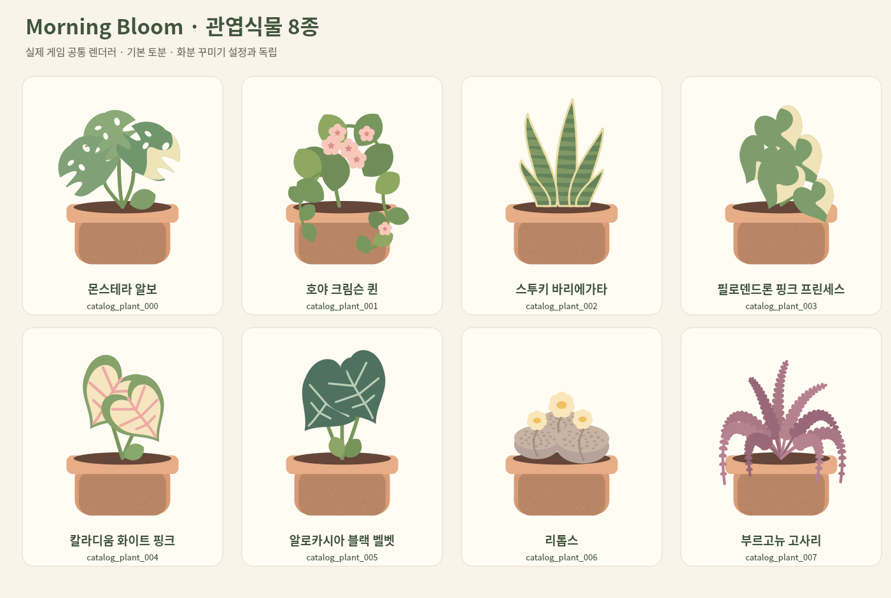
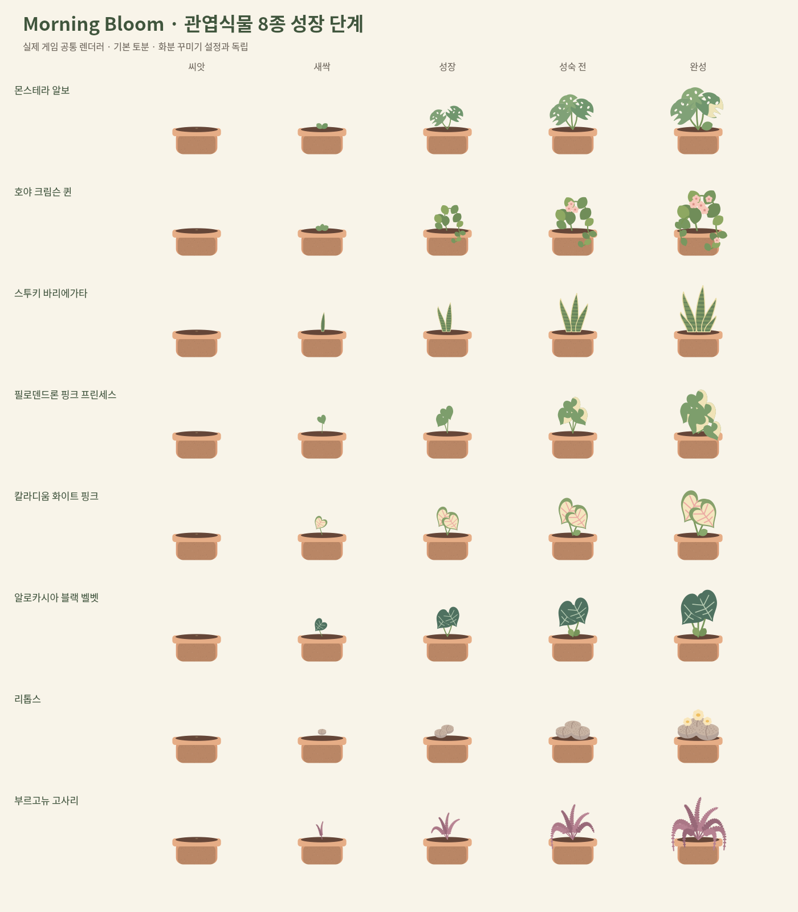

# 관엽식물 레퍼런스 반영

사용자가 제공한 8종 식물 일러스트와 5종 성장 단계 시트를 바탕으로 게임의 공통 벡터 렌더러를 수정했습니다. 원본 이미지를 그대로 붙이는 방식이 아니라 작은 카드에서도 식물별 특징을 읽을 수 있도록 형태를 재구성했습니다.

| 식물 | 반영한 특징 |
| --- | --- |
| 몬스테라 알보 | 둥근 잎, 가장자리 갈라짐, 내부 구멍, 완성 단계의 크림 무늬 |
| 호야 크림슨 퀸 | 둥근 타원 잎, 늘어지는 덩굴, 분홍 꽃송이 |
| 스투키 바리에가타 | 크림 테두리, 가로 무늬, 1→2→3→5장의 잎 |
| 필로덴드론 핑크 프린세스 | 하트형 잎과 크림 무늬 — 기존 이름을 유지하고 제공 이미지의 색을 따름 |
| 칼라디움 화이트 핑크 | 녹색 가장자리, 크림색 내부, 분홍 잎맥 |
| 알로카시아 블랙 벨벳 | 짙은 녹색 잎, 밝은 잎맥, 밑동의 어린 잎 |
| 리톱스 | 갈라진 돌 모양, 점무늬, 완성 단계의 연노랑 꽃 |
| 부르고뉴 고사리 | 자주색 곡선 잎줄기, 둥근 작은 잎, 아래로 처지는 외곽 잎 |

성장 시트에 등장하는 5종은 잎 수와 구조가 단계별로 달라집니다. 다른 3종도 같은 방향으로 성장 모습을 구성했습니다. 성장 시간·단계 판정·등급·뽑기 확률은 바뀌지 않습니다. 화분 스킨과 색상은 기존 꾸미기 설정을 따릅니다.

## 실제 렌더링





다음 명령으로 미리보기를 다시 만들 수 있습니다. 플레이어 저장 파일을 열지 않습니다.

```sh
QT_QPA_PLATFORM=offscreen PYTHONPATH=python python python/tools/capture_foliage_previews.py --output docs/images/foliage-reference.png
QT_QPA_PLATFORM=offscreen PYTHONPATH=python python python/tools/capture_foliage_previews.py --stages --output docs/images/foliage-growth-stages.png
```

`test_foliage_art.py`는 8종의 모든 성장 단계와 좌우 흔들림에서 카드 경계, 메인 화분·분무 게임의 공통 장면, 바탕화면 화분 마스크를 검사합니다. 꽃·무늬의 등장 단계와 호출자의 QPainter 상태 복원도 검사합니다.
