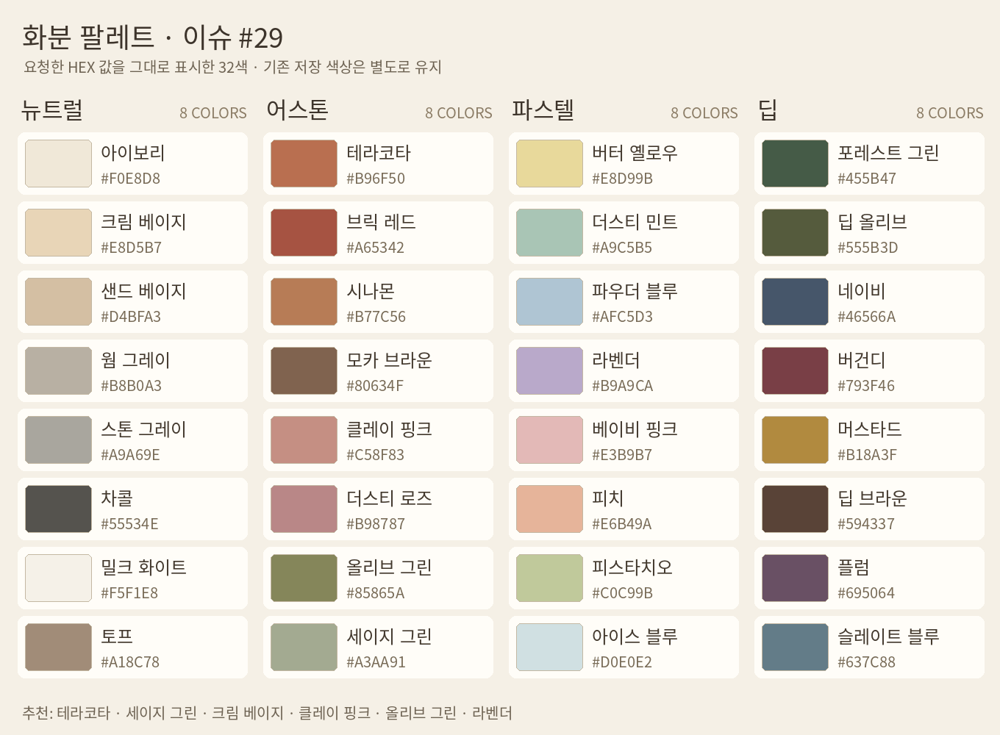
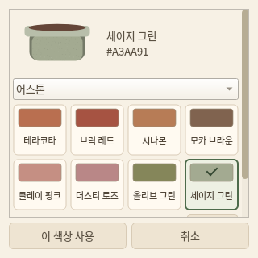
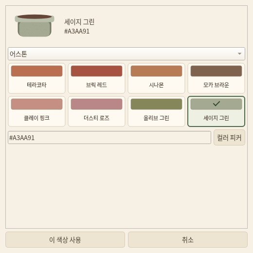

# 이슈 #29 · 화분 팔레트 요구·구현 보고

2026-11-06. [이슈 #29](https://github.com/badbed7/morning-bloom/issues/29)의 색상 32개와 UI 제안을 v0.8.21에 반영한다. [릴리즈 변경 사항](../release/notes/v0.8.21.md).

## 요구사항과 구현

| 항목 | 구현 내용 |
|---|---|
| 32색 확대 | 뉴트럴·어스톤·파스텔·딥 각 8개, 이슈의 HEX 값과 일치 |
| 분위기별 탐색 | 카테고리 선택과 실제 RGB 색상칩, 선택 체크·이름·HEX 표시 |
| 추천색 | 테라코타·세이지 그린·크림 베이지·클레이 핑크·올리브 그린·라벤더 및 기본색 복귀 |
| 사용자 지정 | 6자리 HEX 입력과 컬러 피커, 실시간 미리보기 |
| 질감 | 기본 토분 본체에 고정된 미세 입자 표현, 무광 바탕색과 테두리 톤 유지 |
| 저장 호환 | 기존 7개 색상 ID와 RGB를 그대로 유지하고 별도 새 ID로 32색 추가 |

아래 색상표는 실제 등록된 HEX 값을 그대로 채워 렌더링했다. 색상칩 중앙 픽셀의 RGB와 정의값이 일치하는지 확인했다.

## 사용 흐름

1. 정원에서 식물을 클릭하거나 재배 화면의 `화분 꾸미기`를 연다.
2. 원하는 보유 화분을 고르고 `색상` 버튼을 누른다.
3. 추천·뉴트럴·어스톤·파스텔·딥·이전 색상 중 카테고리를 골라 색상칩을 선택한다. HEX 입력 또는 컬러 피커도 사용할 수 있다.
4. 미리보기로 확인하고 `이 색상 사용`을 누른다. 이 단계는 바깥 화분 선택 화면에만 반영한다.
5. `이 화분에 담기`를 누르면 해당 식물·슬롯의 외형을 저장한다.

색상 선택 취소는 바깥 화면의 이전 선택을 유지한다. 바깥 화분 선택을 취소하면 실제 정원 설정을 유지한다. 컬러 피커 취소도 현재 선택을 바꾸지 않는다. 저장 실패 시 실제 설정을 복구하고 선택 화면을 유지한다. 씨앗·재화·성장 진행은 바꾸지 않는다.

## 사용자 색상과 기존 색상

- HEX 입력은 `#RRGGBB` 또는 `RRGGBB`를 받는다. 모델에는 `#rrggbb`로 저장한다. 불완전한 값·잘못된 문자·알파 포함 형식은 적용을 막고 안내한다.
- 기존 색상 `original`, `beige`, `charcoal`, `burgundy`, `ivory`, `sage`, `blue`의 이름·값을 유지한다. 예를 들어 이전 아이보리 `#F0E5CE`를 새 아이보리 `#F0E8D8`로 자동 변경하지 않는다.
- 기본 원래 색상으로 돌아가면 `original`을 저장한다. 특정 식물의 화분색을 새로 강제 지정하지 않는다.
- 색상은 모든 식물 개체에 독립적으로 적용된다. 같은 종류의 화분도 서로 다른 색상으로 사용할 수 있다. 기존 미보유 화분의 적용 제한은 유지한다.

## 렌더링과 저장

기본 토분의 미세 입자는 고정된 반투명 타일을 사용한다. 프레임마다 입자가 바뀌지 않고 게임 난수도 소비하지 않는다. 화분 본체 영역에만 입자를 그리며 흙·꽃잎 영역은 유지한다. 다른 화분의 무늬·재질 디자인은 기존 렌더러를 사용한다.

재배·정원·드래그 미리보기·보관 목록·플로팅·분무 화면은 같은 색상 해석과 공통 화분 렌더러를 사용한다.

저장 v21은 새 색상 ID와 사용자 HEX를 허용한다. v20 저장은 기존 값과 필드를 그대로 보존하고 스키마만 v21로 이전한다. 더 오래된 저장은 기존 이전 경로를 거친다. 로컬 원문 백업·클라우드 복원·저장 실패 복구는 기존 경로를 사용한다. 과거 저장의 잘못된 색상 값이 새 팔레트 추가만으로 유효해지지 않도록 이전 단계에서 과거 7색 정의로 검증한다.

## 자동 검증

`python/tests/test_pot_palette.py`에서 이슈의 정확한 32개 HEX, 그룹별 수량, 기존 색상 보존, 사용자 RGB 검증·정규화, 원문 백업·클라우드 왕복, 성장·수확 후 색상 유지, 질감의 결정성·꽃잎 보존, 색상/화분/컬러 피커의 취소와 저장 실패, 320px·520px 스크롤·적용 버튼·키보드 선택을 검사한다. 기존 저장·재배·가챠·UI 회귀 테스트도 실행한다.

## 색상 정의

| 계열 | 색상 | HEX | 저장 ID |
|---|---|---|---|
| 뉴트럴 | 아이보리 | `#F0E8D8` | `neutral_ivory` |
| 뉴트럴 | 크림 베이지 | `#E8D5B7` | `cream_beige` |
| 뉴트럴 | 샌드 베이지 | `#D4BFA3` | `sand_beige` |
| 뉴트럴 | 웜 그레이 | `#B8B0A3` | `warm_gray` |
| 뉴트럴 | 스톤 그레이 | `#A9A69E` | `stone_gray` |
| 뉴트럴 | 차콜 | `#55534E` | `neutral_charcoal` |
| 뉴트럴 | 밀크 화이트 | `#F5F1E8` | `milk_white` |
| 뉴트럴 | 토프 | `#A18C78` | `taupe` |
| 어스톤 | 테라코타 | `#B96F50` | `terracotta` |
| 어스톤 | 브릭 레드 | `#A65342` | `brick_red` |
| 어스톤 | 시나몬 | `#B77C56` | `cinnamon` |
| 어스톤 | 모카 브라운 | `#80634F` | `mocha_brown` |
| 어스톤 | 클레이 핑크 | `#C58F83` | `clay_pink` |
| 어스톤 | 더스티 로즈 | `#B98787` | `dusty_rose` |
| 어스톤 | 올리브 그린 | `#85865A` | `olive_green` |
| 어스톤 | 세이지 그린 | `#A3AA91` | `sage_green` |
| 파스텔 | 버터 옐로우 | `#E8D99B` | `butter_yellow` |
| 파스텔 | 더스티 민트 | `#A9C5B5` | `dusty_mint` |
| 파스텔 | 파우더 블루 | `#AFC5D3` | `powder_blue` |
| 파스텔 | 라벤더 | `#B9A9CA` | `pastel_lavender` |
| 파스텔 | 베이비 핑크 | `#E3B9B7` | `baby_pink` |
| 파스텔 | 피치 | `#E6B49A` | `peach` |
| 파스텔 | 피스타치오 | `#C0C99B` | `pistachio` |
| 파스텔 | 아이스 블루 | `#D0E0E2` | `ice_blue` |
| 딥 | 포레스트 그린 | `#455B47` | `forest_green` |
| 딥 | 딥 올리브 | `#555B3D` | `deep_olive` |
| 딥 | 네이비 | `#46566A` | `navy` |
| 딥 | 버건디 | `#793F46` | `deep_burgundy` |
| 딥 | 머스타드 | `#B18A3F` | `mustard` |
| 딥 | 딥 브라운 | `#594337` | `deep_brown` |
| 딥 | 플럼 | `#695064` | `plum` |
| 딥 | 슬레이트 블루 | `#637C88` | `slate_blue` |

로컬 검증 결과: 전체 게임 테스트 298개 중 297개 통과·환경 선택 1개 건너뜀, 런처·패키징 44개 통과. Qt에서 320px·520px 선택 화면을 렌더링해 스크롤·색상칩·적용 버튼을 확인했다.
