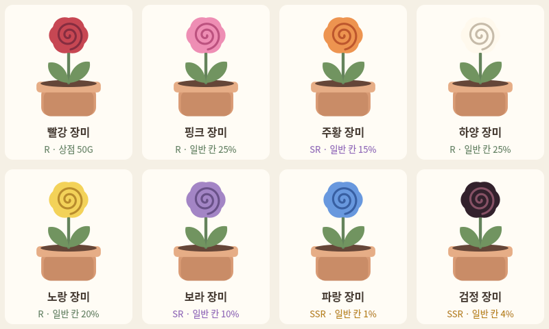

# 장미 8색 · 획득 경로와 확률

2026-11-05, v0.8.20. [릴리즈 변경 사항](../release/notes/v0.8.20.md).

## 변경과 유지

- 품종별 기본 토분 색상 지정은 철회한다. 장미·데이지의 토분 기본값과 공통 테두리를 이전 상태로 복구한다.
- 사용자가 고른 개별 화분 종류·색상은 그대로 보존한다.
- 장미 꽃잎을 8색의 별도 품종으로 만든다. 기존 `rose` ID는 빨강 장미로 유지한다.
- 빨강만 골드 상점에서 50G로 구매한다. 나머지는 `장미 씨앗` 뽑기에서만 획득하며 획득 후에도 상점에서 구매할 수 없다.
- 색상은 씨앗을 뽑을 때 결정한다. 심기·개화·재실행 때 다시 추첨하지 않는다.
- 전 품종의 성장 3일, 기본 판매 150G, 분무 보너스 15G는 기존 장미와 동일하다. 희귀도는 색상 수집의 차등이며 성장 성공률이나 능력치 확률이 아니다.

## 현실 자료와 게임 수치의 구분

요청한 8색이 공통으로 일정한 확률로 피어난다는 실측 통계는 확인하지 못했다. 색상은 유전적 배경, 색소 종류·양, 공색소와 세포 환경 등에 영향을 받는다. 특정 교배 집단의 결과를 모든 장미의 색상별 자연 발생률로 일반화하지 않는다.

- [RHS: Modern bush roses](https://www.rhs.org.uk/plants/roses/modern-bush): 빨강·핑크·하양·노랑·주황·보라 등의 원예 색상과 순수한 파랑·검정의 부재를 설명한다.
- [Suntory, 2026-08-31 연구 발표](https://www.suntory.com/news/article/2026/15111E.html): 파란 장미는 자연적으로 발생하지 않으며 분자 육종·공색소 조합을 통해 보랏빛 파랑을 구현했다고 보고한다. 게임의 파랑은 특수 육종을 모티브로 한 색상 표현이다.
- [Meilland: original colours](https://ie.meillandrichardier.com/rosiers/rosiers-par-couleur/coloris-originaux): Black Baccara 등 가장 검게 보이는 원예 품종을 소개한다. 게임의 검정은 순수 검정의 자연 발생을 주장하지 않는 흑적색 표현이다.
- [Inheritance and QTL analysis of the determinants of flower color in tetraploid cut roses, 2016](https://link.springer.com/article/10.1007/s11032-016-0565-9): 특정 집단의 꽃색·색소 형질과 유전 위치를 연구하며, 보편적인 8색 발생률을 제공하지 않는다.

아래 등급과 수치는 현실의 색상·육종 특성을 참고한 **게임 설계값**이다. 핑크·하양·노랑·주황·보라 사이의 정량적 자연 발생 빈도 순서를 입증하는 수치가 아니다. 파랑·검정을 SSR로 두고 파랑을 더 낮은 가중치로 둔 것은 수집 게임을 위한 선택이다. UI에도 실측값이 아님을 명시한다.

## 등급과 기본 확률

아래 확률은 **장미 씨앗 분류를 선택하고 보장 없는 일반 칸에 도착한 경우의 등급 추첨 기준**이다. 색상 7종의 합은 100%다. 보드 주사위를 굴리기 전의 무조건부 확률이나 자연 개화율이 아니다.

| 색상 | ID | 등급 | 획득 경로 | 일반 칸 기준 | 등급 내 가중치 |
|---|---|---|---|---:|---:|
| 빨강 | `rose` | R | 상점 50G | 0% | 뽑기 제외 |
| 핑크 | `rose_pink` | R | 장미 씨앗 뽑기 | 25% | 5/14 |
| 주황 | `rose_orange` | SR | 장미 씨앗 뽑기 | 15% | 3/5 |
| 하양 | `rose_white` | R | 장미 씨앗 뽑기 | 25% | 5/14 |
| 노랑 | `rose_yellow` | R | 장미 씨앗 뽑기 | 20% | 4/14 |
| 보라 | `rose_purple` | SR | 장미 씨앗 뽑기 | 10% | 2/5 |
| 파랑 | `rose_blue` | SSR | 장미 씨앗 뽑기 | 1% | 1/5 |
| 검정 | `rose_black` | SSR | 장미 씨앗 뽑기 | 4% | 4/5 |

기존 R 70% / SR 25% / SSR 5%의 등급 규칙, 비용, 무료권, 두 주사위, 곁길 2회, 천장은 유지한다. 분류를 바꿔도 보드와 천장은 공유한다. 기존 식물 8종·정원·화분의 등급 내 균등 추첨은 유지한다.

특수 칸·10회 SR 보장·60회 SSR 보장에 따라 실제 개별 확률은 달라진다. 예를 들어 황금 곁길 또는 SSR 천장은 검정 80% / 파랑 20%다. `확률 상세`는 현재 보드 상태에서 주사위 36조합과 도착 칸·천장을 반영해 다음 1회의 정확한 확률을 분수로 계산하고 화면에는 소수점 4자리까지 표시한다. 10회 묶음은 매회 위치·보장이 바뀌므로 단일 고정 확률로 설명하지 않는다.

## 지급·저장·표시

- 첫 획득과 중복 모두 해당 장미 씨앗 1개를 지급한다. 중복 표시는 최초 획득 기록 기준이며 교환잎은 기존 등급별 지급 규칙을 유지한다.
- 거래 저장 후 연출과 정산을 표시한다. 저장 실패·건너뛰기·닫기로 씨앗이 사라지거나 두 번 지급되지 않는다.
- 심기 목록은 가진 씨앗만 표시한다. 상점 목록에는 빨강 장미만 포함한다.
- 도감 157종 중 식물은 29종이며 장미는 8종이다. 이름·등급·씨앗 수량·가챠 전용 경로를 표시한다.
- 재배·정원·드래그·플로팅·분무·도감·가챠 결과가 같은 장미 벡터 렌더러를 사용한다.
- 저장 v20: v19 씨앗 목록에 새 7종의 수량 0만 추가한다. 기존 `rose`의 식물 ID·씨앗 수·성장·수확 기록·재화·뽑기 이력·개별 화분 설정을 보존한다. 로컬 원문 백업과 클라우드 복원도 같은 이전 경로를 따른다.

## 검증

`python/tests/test_rose_varieties.py`는 8색 구분, 빨강 전용 상점 경로, 가중치 구간의 시작·끝, 중복 씨앗 지급, 성장·수확 후 품종·ID 유지, 잘못된 추첨값과 저장 실패 복구, v19 원문 백업·클라우드 복원·재실행을 검사한다. 현재 다음 1회 확률은 여러 보드·천장 상태의 주사위 36조합과 등급 추첨 구간을 실제 추첨 결과와 비교한다. Qt에서 320px·520px 확률표와 10회 정산을 검사한다.

로컬 검증: 게임 테스트 287개 중 286개 통과·환경 선택 테스트 1개 건너뜀, 런처·패키징 44개 통과. 확률 표시를 공통 계산으로 정리한 뒤 관련 장미·가챠 테스트 30개도 통과했다. 8색과 320px·520px 확률표를 실제 Qt 렌더링으로 확인했다.
