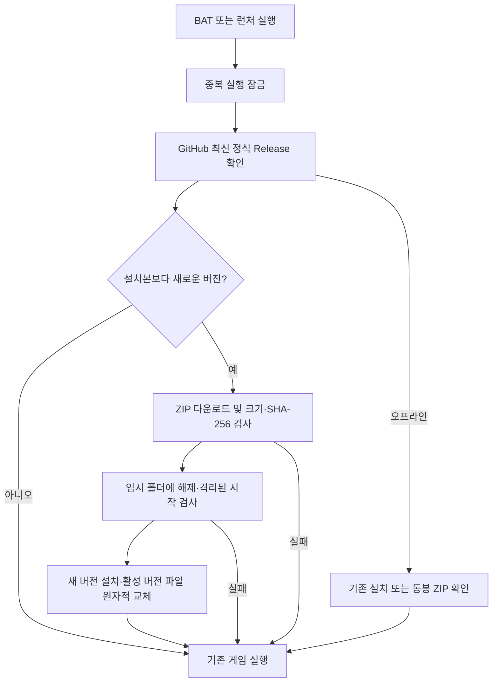

# Windows / Python BAT 배포와 자동 업데이트

## v0.8.10 · 상점 꽃길 뽑기 진입 강조

상점 맨 위에 꽃길 뽑기 강조 카드와 큰 버튼을 배치했습니다. 무료권 수와 1회/10회 비용을 바로 표시하며, 작은 창에서도 버튼을 확인하고 보드를 열 수 있습니다. 씨앗 구매는 아래로 스크롤해 이용합니다.

## v0.8.9 · 60칸 프리뷰 동기화와 0.8.8 대체 배포

v0.8.8 공개 릴리즈는 철회하고 Draft로 전환했습니다. 이 버전은 주사위 2개(합 2~12칸), 민들레 씨의 칸별 이동, 60번 다음 1번 순환, 도착 칸 보상, 10회 연속 연출 및 건너뛰기를 제공합니다. `docs/gacha-board-preview.html`도 같은 흐름으로 갱신했습니다. 기존 저장을 유지합니다. 기존 런처를 새 ZIP의 런처로 교체하는 안내는 아래와 같습니다.

## v0.8.8에서 도입한 업데이트 조회와 구버전 실행 안내 수정

- 기존 최신 버전 조회의 5초 제한으로 실패하는 현상을 재현했다. 조회 대기를 15초로 늘리고, GitHub Release API로 버전을 확인한 뒤 해당 버전의 고정 업데이트 주소를 읽는다. API가 실패하면 기존 공개 주소로 재시도한다.
- 조회·설치 실패로 이전 게임을 실행할 때 현재 버전과 진단 로그 위치를 안내한다. `update.log`에도 이전·최신 확인·실제 선택 버전을 기록한다.
- **기존 런처 파일 자체는 게임 자동 업데이트로 바뀌지 않는다. 이번에는 v0.8.8 Python-BAT 또는 Windows-x64 ZIP을 새 폴더에 전체 해제하고 그 폴더의 BAT/런처로 한 번 실행해야 한다.** 저장 폴더를 지우지 않으며, 로컬에 동봉된 최신 게임도 설치할 수 있다.
- Python-BAT는 `run-python.bat`, EXE 묶음은 `MorningBloom.exe`로 실행한다. `MorningBloomGame.exe`나 소스를 직접 실행하면 런처의 업데이트 검사를 거치지 않는다.
- v0.8.7의 주사위 2개·민들레 씨 이동과 로즈·교환잎 기능을 포함한다.

## v0.8.7 · 주사위 2개와 민들레 씨 이동

- 독립적인 6면 주사위 2개의 합인 2~12칸을 이동합니다. 60번 다음은 1번으로 이어집니다.
- 주사위를 굴려 눈과 합을 표시한 뒤 민들레 씨가 경로를 따라 부드럽게 이동합니다. 최종 도착 칸에서 보상 한 개를 받습니다.
- 10회 뽑기는 회차별로 연출하며 건너뛰기·닫기에도 미리 저장한 보상과 재화는 유지합니다.
- 기존 v14 저장과 로즈·교환잎 상점을 유지합니다. 특수 칸은 정확히 도착했을 때만 발동합니다.

## v0.8.6 · 로즈 화분과 교환잎 비료 상점

- 로즈 리본 화분은 햇빛 직접 구매를 막고 화분 뽑기 SSR로 획득합니다. 기존 소유권과 장착은 보존합니다.
- 상점에서 교환잎 5개로 비료 1개를 구매합니다. 비료 보유 상한 5개이며, 잎 부족·재고 가득 참·저장 실패 때 잎이 유실되지 않습니다.
- 비용·확률·곁길의 현재 구현 범위는 [현재 가챠 규칙](../docs/gacha-current-rules.ko.md)에 정리합니다. v0.8.6은 기존 v14 저장 구조를 유지합니다.

## v0.8.5 · 60칸 꽃길 뽑기

상점에서 직사각형 60칸 보드를 엽니다. 1회당 햇빛 10개(10회 100개)를 사용하며, 처음 3회는 무료권으로 진행할 수 있습니다. 뽑기마다 한 칸씩 이동하는 애니메이션이 나오고, 11·26·41번은 SR 이상, 56번은 SSR 확정입니다. 특수 칸에는 곁길 출입구가 표시됩니다. 이번 버전의 보상은 기존 정원 배경·화분 스킨이며, 신규 도감 아이템과 능력치 효과는 아직 적용되지 않았습니다. 기존 저장은 보드 진행이 추가되는 v14 형식으로 이전되며 원본 백업을 남깁니다.

현재 배포 경로는 공개 저장소 [badbed7/morning-bloom Releases](https://github.com/badbed7/morning-bloom/releases)입니다. GitHub 계정이나 토큰 없이 업데이트를 받습니다. 사용자 배포에는 MSIX를 사용하지 않습니다.

빌드는 `release/build_icons.py`로 데이지 꽃머리 PNG·다중 해상도 ICO를 생성하고 게임 EXE와 런처에 포함합니다. Python BAT 묶음에도 런처용 ICO를 포함합니다. 게임 창은 같은 그림을 자체 생성하므로 소스 실행에도 아이콘이 표시됩니다.

## 사용자 실행

- **Python 유지:** 최신 `MorningBloom-<버전>-Python-BAT.zip`을 전부 풀고 `run-python.bat`을 실행합니다. Python 3.12 64비트, Python Launcher와 Tcl/Tk를 한 번 설치해야 합니다. 첫 의존성 설치에는 인터넷이 필요합니다.
- **EXE:** 최신 `MorningBloom-<버전>-Windows-x64.zip`을 전부 풀고 `MorningBloom.exe` 또는 같은 폴더의 `run.bat`을 실행합니다. Python을 따로 설치하지 않습니다.

BAT나 EXE만 다른 곳으로 옮기지 마세요. 함께 들어 있는 ZIP과 버전 정보를 보관하면 네트워크 오류 시에도 포함된 버전을 설치할 수 있습니다. Python 의존성이 이미 준비된 PC는 오프라인으로도 시작할 수 있습니다.

**v0.6.0 이하의 BAT·런처는 v0.7.0 배포 ZIP으로 한 번 교체해야 합니다.** 이전 BAT는 업데이트 검사가 없었고, 이전 EXE는 존재하지 않는 `morning-bloom-releases` 주소로 빌드되었습니다. 게임 저장은 그대로 사용합니다. 이후에는 같은 BAT·런처로 실행하면 됩니다.

## 실행 순서



업데이트 점검 후 게임을 시작하므로, 새 버전을 발견하면 별도의 수동 업데이트 버튼 없이 그 실행부터 적용합니다. 동봉 ZIP이 원격 최신 버전과 같으면 다운로드하지 않습니다. 신규 설치에서는 원격 버전과 동봉 버전 중 가장 최신의 정상 버전을 설치합니다. 둘 다 준비할 수 없으면 오류와 로그 경로를 표시합니다.

EXE는 `update.json`과 `MorningBloom-game.zip`, Python BAT는 `python-update.json`과 `MorningBloom-python.zip`을 사용합니다. 각각 `version`, `size`, `sha256`, 허용된 GitHub 다운로드 주소를 검사합니다. 두 방식은 같은 버전별 설치·원자적 교체 코드를 공유합니다.

Python 버전은 EXE로 변환하지 않고 `.py` 파일을 별도 Python 프로세스로 실행합니다. 의존성은 Python 버전과 `requirements.txt` 해시별 가상 환경으로 보관하며 준비된 환경에서는 pip를 다시 실행하지 않습니다. 새 의존성 설치에 실패해도 이전 버전의 환경을 변경하지 않습니다.

## 저장 보존과 실패 처리

| 위치 | 용도 |
| --- | --- |
| `%LOCALAPPDATA%/MorningBloomPython` | 기존 일반·개발자 정원과 백업. 두 실행 방식이 공유 |
| `%LOCALAPPDATA%/MorningBloomLauncher` | EXE 설치·현재 버전·업데이트 로그·공용 실행 잠금 |
| `%LOCALAPPDATA%/MorningBloomPythonLauncher` | Python 설치·가상 환경·현재 버전·로그 |

설치 파일만 교체합니다. 저장 폴더는 압축 해제와 삭제 대상에 포함하지 않습니다. 새 버전은 빈 임시 정원으로 시작 검사를 통과한 뒤에만 활성화합니다. 게임을 실제 실행할 때 기존 저장 이전·백업 기능을 사용합니다.

다운로드 중단, 손상된 ZIP, 위험한 압축 경로, 의존성 설치 실패, 실행 점검 실패 시 현재 버전 포인터를 바꾸지 않습니다. 이전 설치는 남겨 둡니다. 저장 형식이 바뀔 수 있으므로 실제 게임을 실행한 이후에는 임의로 이전 버전으로 되돌리지 않습니다.

BAT와 EXE는 공용 잠금을 게임 종료까지 유지합니다. 이미 실행 중이면 두 번째 런처는 종료하고 다음 실행에서 업데이트합니다. 실행 중인 게임을 강제로 종료하거나 그 파일을 덮어쓰지 않습니다.

각 설치 폴더의 `update.log`는 조회·업데이트 실패, `startup-check.log`는 새 버전 시작 점검, Python의 `python-setup.log`는 의존성 설치 오류를 기록합니다.

## 새 버전 배포

1. 코드와 테스트를 완료합니다.
2. `release/VERSION`을 이전보다 높은 버전으로 올립니다.
3. main에 push하면 **Windows release**가 EXE와 Python BAT를 모두 빌드하고 실행 검사합니다.
4. 모든 ZIP과 두 업데이트 JSON을 draft Release에 올린 뒤, 정식 최신 Release로 한 번에 게시합니다.
5. 인증 정보 없이 두 공개 업데이트 주소를 조회해 게시 버전을 확인합니다. 사용자는 다음 실행에서 새 버전을 받습니다.

별도의 배포 전용 저장소나 개인 액세스 토큰은 필요하지 않습니다. 워크플로는 현재 공개 저장소의 기본 `GITHUB_TOKEN`으로 Release를 게시합니다. 저장소를 비공개로 바꾸면 일반 사용자의 업데이트가 중단됩니다.

Google Desktop OAuth 값은 Actions variable `GOOGLE_OAUTH_CLIENT_ID`와 Actions secret `GOOGLE_OAUTH_CLIENT_SECRET`에 설정합니다. 두 값은 설치 앱에 포함되지만 저장소와 CI 로그에는 직접 기록하지 않습니다. 사용자 토큰이나 비밀번호는 패키지에 넣지 않습니다.

Windows / Python 3.12에서 수동 빌드:

```powershell
py -3.12 -m pip install -r python/requirements.txt -r release/requirements-build.txt
py -3.12 release/build_windows.py
py -3.12 release/build_python.py
```

출력은 `release-output`입니다. 자동 빌드는 게임·업데이터 테스트와 EXE·Python 양쪽의 격리된 실행 검사를 통과해야 게시됩니다. 이전의 별도 `Python BAT release` 작업은 이 흐름으로 통합했습니다.

## 범위

새 버전 게임·리소스·Python 의존성을 업데이트합니다. 업데이트 프로토콜이나 런처 자체가 바뀌면 새 배포 ZIP을 한 번 받아야 합니다. 운영체제 보안 기능에 의해 차단된 EXE·DLL의 실행 허용 여부는 이 업데이트 기능과 별개입니다. HTTPS와 SHA-256은 전송 무결성을 검사하며 제작자 코드 서명을 대신하지 않습니다.


